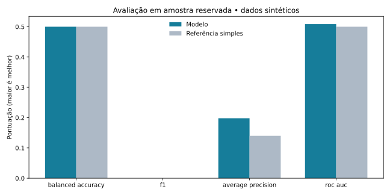

# Classificação de risco em dados financeiros sintéticos

Construir um pipeline de classificação e avaliar uma classe positiva minoritária.

**Escopo:** estudo reproduzível com dados sintéticos. O nome histórico do repositório é mantido; este título e o conteúdo do CSV definem o escopo efetivo. Não são apresentados clientes, resultados comerciais ou autoria individual de entregas anteriores.

## Dados

O código original gera esta base artificialmente. Os valores não descrevem pessoas, empresas ou clientes reais. O CSV foi preservado: **500 linhas, 8 colunas**. Veja o [dicionário de dados](data/README.md).

## Executar

Requisitos: Python 3.11+; versões de bibliotecas testadas em `requirements.txt`.

```bash
python -m venv .venv
# Linux/macOS:
source .venv/bin/activate
# Windows PowerShell, em vez da linha anterior:
# .venv\Scripts\Activate.ps1
python -m pip install -r requirements.txt
python main.py
python -m unittest -v test_analysis.py
```

Baixe o código pelo botão **Code → Download ZIP**, extraia e abra um terminal na pasta do projeto. O programa usa caminhos relativos ao próprio arquivo, não baixa dados e não altera o CSV. O [notebook](notebooks/main.ipynb) oferece a mesma análise em etapas; Jupyter ou a extensão de notebooks do VS Code é opcional e deve ser instalada separadamente.

## Método

Os atributos, a tarefa, a separação e os limites ficam explícitos em [`project.json`](project.json). Em tarefas preditivas, a avaliação usa uma amostra reservada e um baseline; transformações aprendidas nunca usam o teste. Em análises temporais ou por campanha, a separação respeita tempo ou grupo. Bases inadequadas para classificação recebem análise de qualidade, sem métricas preditivas artificiais.

## Resultados



- [Relatório com resultados calculados](reports/report.md)
- [Métricas e identificação do arquivo de entrada](reports/metrics.json)
- [Previsões ou tabelas agregadas](reports/results.csv)
- [Resumo em PDF](reports/report.pdf)

O hash SHA-256 do CSV é registrado junto às métricas. A semente aleatória é 42. As saídas anteriores foram substituídas por resultados da execução revisada, sem apagar o histórico do Git.

## Limitações

O alvo foi gerado de forma independente dos atributos. Eventuais diferenças de desempenho neste recorte são variação amostral, não evidência de capacidade preditiva em produção. Não utilizar para decisões de crédito; client_id é apenas identificador sintético e fica fora do modelo.

## Estrutura

| Arquivo | Finalidade |
|---|---|
| `main.py` | Pipeline executável e geração dos relatórios |
| `project.json` | Configuração e hipóteses específicas deste estudo |
| `data/` | CSV preservado e dicionário |
| `notebooks/main.ipynb` | Leitura interativa da análise |
| `reports/` | Saídas calculadas e reproduzíveis |
| `test_analysis.py` | Testes de separação, vazamento e consistência de métricas |

## Licença

Consulte [LICENSE](LICENSE).
