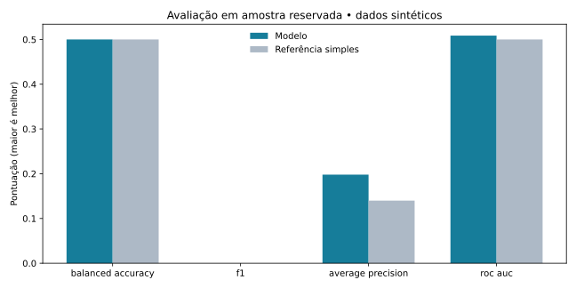

# Classificação de risco em dados financeiros sintéticos

Construir um pipeline de classificação e avaliar uma classe positiva minoritária.

## Limitações

O alvo foi gerado de forma independente dos atributos. Eventuais diferenças de desempenho neste recorte são variação amostral, não evidência de capacidade preditiva em produção. Não utilizar para decisões de crédito; client_id é apenas identificador sintético e fica fora do modelo.

## Resultados calculados

```json
{
  "task": "classification",
  "split": "stratified",
  "train_rows": 350,
  "test_rows": 150,
  "features": [
    "age",
    "annual_income",
    "credit_score",
    "num_transactions",
    "savings_balance",
    "loan_amount"
  ],
  "target": "default_risk",
  "model": "RandomForestClassifier",
  "baseline": "DummyClassifier",
  "model_metrics": {
    "accuracy": 0.86,
    "balanced_accuracy": 0.5,
    "precision": 0.0,
    "recall": 0.0,
    "f1": 0.0,
    "confusion_matrix": [
      [
        129,
        0
      ],
      [
        21,
        0
      ]
    ],
    "roc_auc": 0.5086747877445552,
    "average_precision": 0.19800048704854836
  },
  "baseline_metrics": {
    "accuracy": 0.86,
    "balanced_accuracy": 0.5,
    "precision": 0.0,
    "recall": 0.0,
    "f1": 0.0,
    "confusion_matrix": [
      [
        129,
        0
      ],
      [
        21,
        0
      ]
    ],
    "roc_auc": 0.5,
    "average_precision": 0.14
  },
  "test_positive_rate": 0.14,
  "data_rows": 500,
  "data_columns": 8,
  "data_sha256": "00d2be52eed8a48b83fe5c70ac8bf4493e45a2270ba132911236958a4b9166b8",
  "missing_cells": 0,
  "random_seed": 42,
  "data_origin": "synthetic",
  "limitations": "O alvo foi gerado de forma independente dos atributos. Eventuais diferenças de desempenho neste recorte são variação amostral, não evidência de capacidade preditiva em produção. Não utilizar para decisões de crédito; client_id é apenas identificador sintético e fica fora do modelo."
}
```


